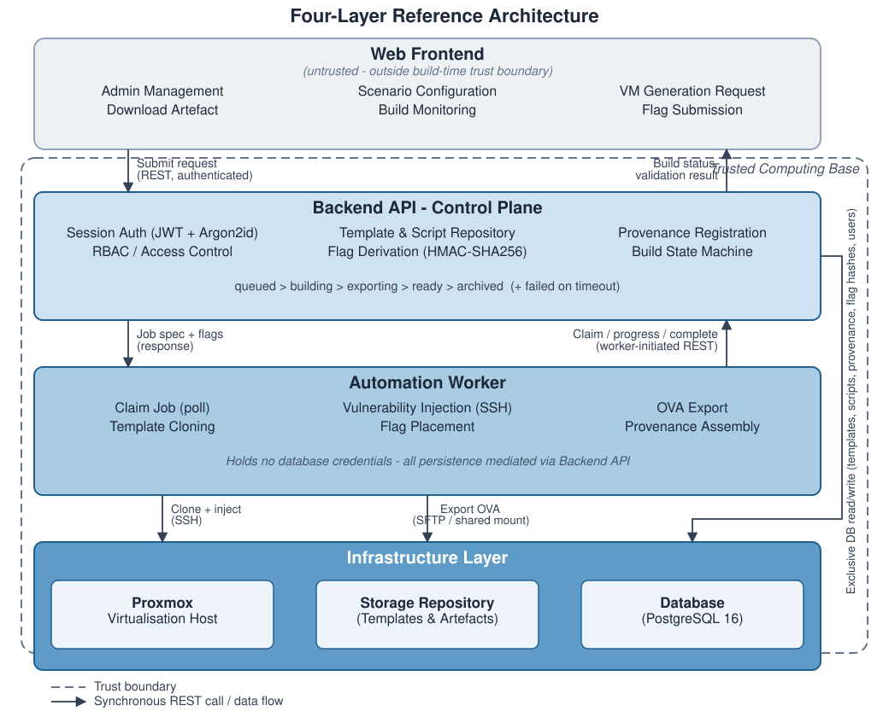
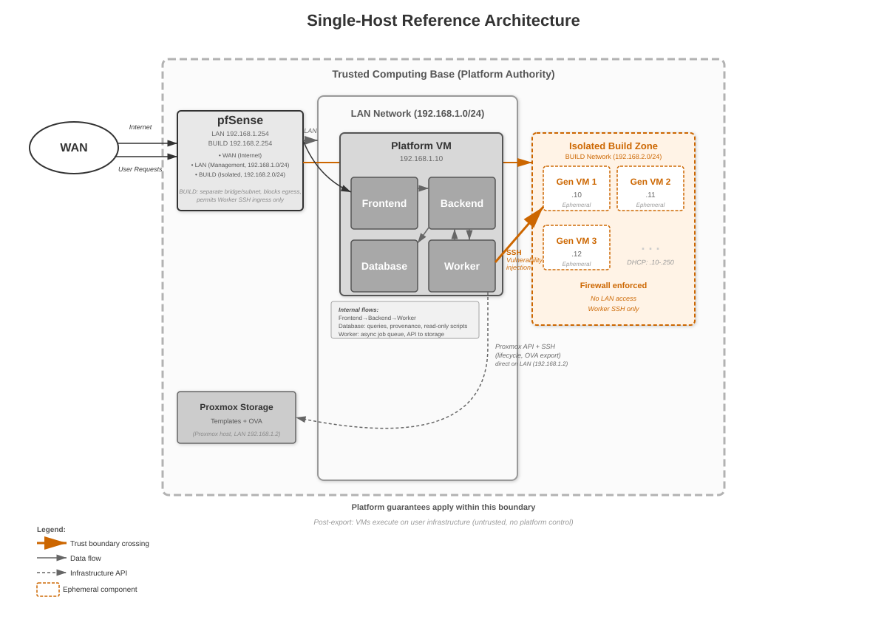
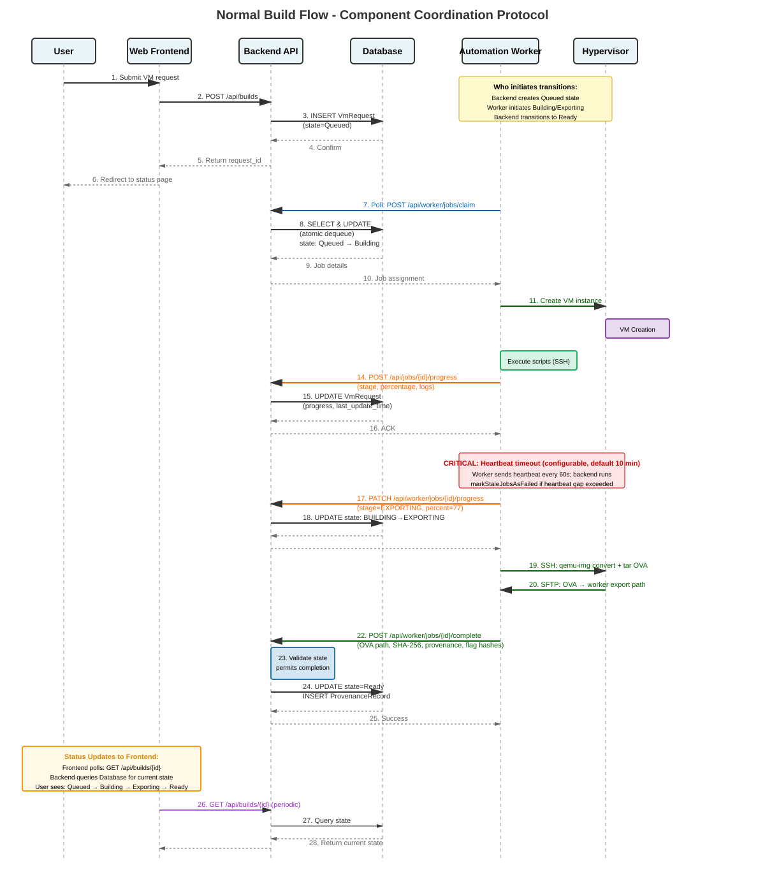
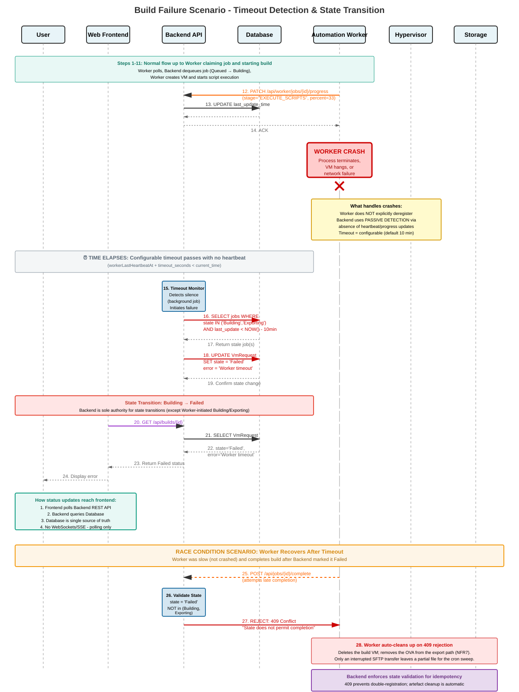

# VMGen documentation

| Document | Contents |
|----------|----------|
| [ARCHITECTURE.md](ARCHITECTURE.md) | Full system architecture: layers, build pipeline, flag system, provenance, security model, deployment |
| [OPERATIONS.md](OPERATIONS.md) | Commands for running, debugging and maintaining a deployment |
| [components/backend](components/backend) | Backend walkthroughs: layering, security, auth, build lifecycle, flags, worker pipeline |
| [components/frontend](components/frontend) | Frontend walkthroughs: router, auth store, API client, composables |
| [brain/](brain) | Interactive architecture explorer (see below) |
| [diagrams/](diagrams) | Diagram sources and rendered SVGs |

## Architecture explorer

`brain/vmgen-brain.html` is a self-contained, offline page that lets you browse
188 components, their connections, 16 end-to-end flows, design rationale and
known pitfalls. Open it directly in a browser, or via GitHub Pages
(Settings → Pages → deploy from branch, folder `/docs`).

`brain/vmgen-brain.json` is the source of truth; after editing it, run
`python brain/sync_brain.py` to validate it and re-embed it in the HTML.

## Diagrams

Lab addresses in diagrams and docs are illustrative RFC 1918 values.

### System architecture



### Single-host reference deployment



### Normal build



### Build failure



### Data model

The entity-relationship diagram is defined in DBML:
[full](diagrams/dbml/vmgen_er_diagram.dbml) and
[structure only](diagrams/dbml/vmgen_er_diagram_simple.dbml).
Paste either file into [dbdiagram.io](https://dbdiagram.io) to render it.

### Layout

```text
diagrams/
├── svg/     rendered diagrams
├── puml/    PlantUML sources of the sequence diagrams
└── dbml/    DBML sources of the data model
```
